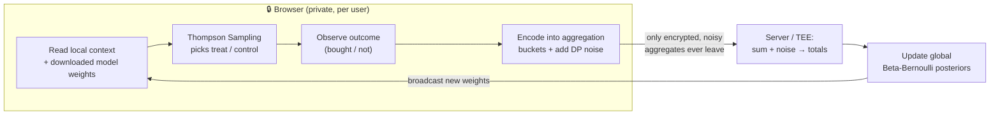
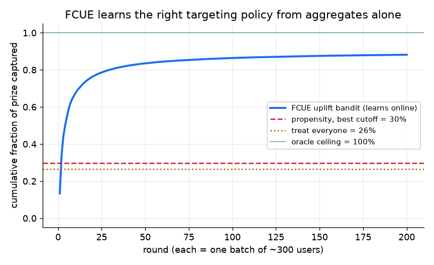
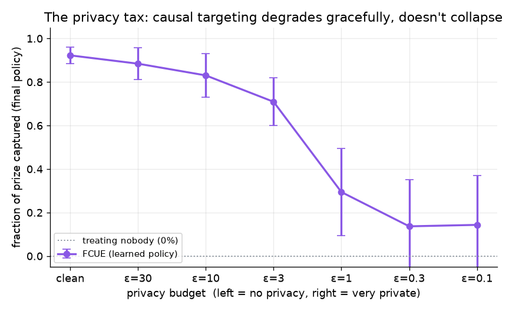
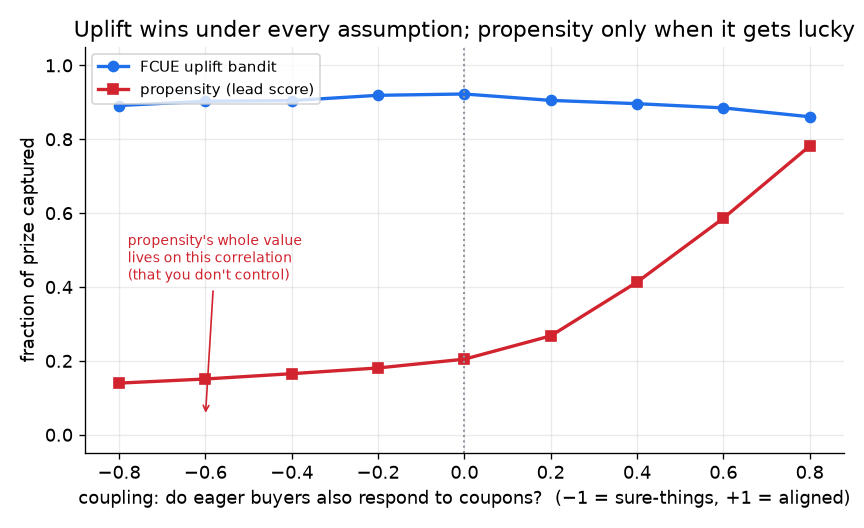
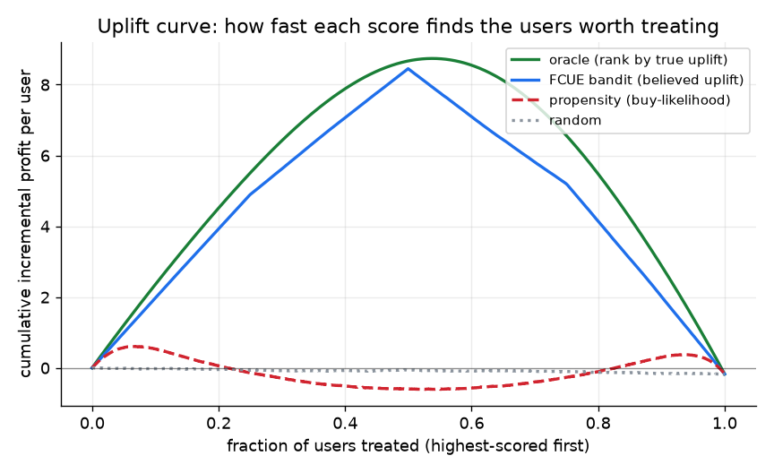

# FCUE — Federated Causal Uplift Engine

A simulation of a **privacy-preserving contextual bandit that optimizes for causal
uplift** — i.e. a system that learns *who to give a marketing incentive to* by
measuring who actually **changes their behavior because of it**, while only ever
seeing **noisy, aggregated data** of the kind the post-cookie web (Google Privacy
Sandbox) will allow.

It is a runnable answer to one question:

> Now that we can no longer track individuals across the web, can we still learn a
> **causal** marketing policy — not just a correlational one — from **aggregate,
> differentially-private** signals? And what does that privacy cost us?

**Short answer, demonstrated with code:** yes, and the cost is a graceful,
measurable degradation — not a collapse.

> [!NOTE]
> This is a **simulation / research prototype**, not a production ad system. It
> models the Privacy Sandbox constraints (aggregation, differential-privacy noise,
> contribution budgets) in NumPy so the core idea can be studied end-to-end without
> Chrome-only APIs or cloud enclaves. See [What's real vs. simulated](#whats-real-vs-simulated).

---

## The problem, in one breath

Two forces are colliding in marketing technology:

1. **Causal inference is winning.** Targeting people *likely to buy* (propensity /
   lead-scoring) wastes money on "sure things" who'd buy anyway and can even annoy
   "sleeping dogs" into leaving. The better question is *who buys **because** of the
   nudge* — **uplift**. ([concepts →](docs/CONCEPTS.md#part-1--the-causal--uplift-side))
2. **Individual tracking is dying.** Third-party cookies are going away. The
   replacement (Google Privacy Sandbox) only lets data leave the browser as
   **noisy aggregates**, never per-user rows. ([concepts →](docs/CONCEPTS.md#part-2--the-privacy-side))

Almost nobody combines the two: advanced causal methods assume the exact
granular, per-user data that privacy now forbids. FCUE is a worked example of
doing causal optimization *inside* the privacy constraints.

## What it does (the loop)



The decision (which coupon?) runs *at the edge* using the user's private features;
only aggregate counts (how many were shown each arm, how many bought) are reported,
with differential-privacy noise; the server updates a global model from those noisy
sums and rebroadcasts. The loop closes without any individual data leaving the device.

The key insight that makes it possible: the bandit uses a **Beta-Bernoulli**
posterior, whose only sufficient statistics are **sums** — and sums are exactly
what an aggregation API produces. Learning from aggregates isn't a hack bolted on;
it's the natural shape of the math.

## Results

All four figures are generated by `python -m experiments.make_figures` and averaged
over multiple random populations (seeds). Metric: **fraction of the "oracle prize"
captured** — the incremental profit earned vs. what a perfect, all-knowing policy
would earn. `1.0` = perfect targeting, `0.0` = no better than treating nobody,
`< 0` = actively destroying value.

### 1. It learns the right policy from aggregates alone


The uplift bandit climbs to ~88% of the perfect-policy prize from aggregate counts,
while propensity/lead-scoring stalls near 30% and blanket-couponing near 26%.

### 2. The privacy tax is graceful, not fatal


As the differential-privacy budget tightens (left → right), performance drops
smoothly: ~92% clean → 83% at ε=10 → 71% at ε=3, before a knee down to ~14% at very
strong privacy. The signal survives enormous per-bucket noise because broad clusters
pool enough users — the project's central claim, measured.

### 3. Uplift wins under every assumption; propensity only when lucky


The `x`-axis is *how correlated "likely to buy" is with "movable by a coupon"* — a
thing you don't control and usually can't observe. The uplift bandit (blue) stays
near 90% everywhere. Propensity (red) is only competitive when that correlation
happens to be strongly positive.

### 4. Ranking by buy-likelihood can destroy value


A Qini-style uplift curve. FCUE (blue) tracks the oracle (green). Propensity (red)
hugs zero and dips **negative** in the middle — spending budget on people the coupon
doesn't move, or actively annoys.

## Quickstart

```bash
python3 -m venv .venv
source .venv/bin/activate          # (fish: source .venv/bin/activate.fish)
pip install -r requirements.txt

# regenerate all four figures (~1 min)
python -m experiments.make_figures

# or poke at the pieces directly
python - <<'PY'
from fcue.world import World, WorldConfig
from fcue.context import coarse_cluster, n_clusters
from fcue.bandit import ContextualThompsonBandit, aggregate_counts
w = World(WorldConfig(seed=0)); K = n_clusters()
b = ContextualThompsonBandit(K, w.cfg.margin, w.cfg.coupon_cost)
for _ in range(150):
    X = w.sample_users(2000); c = coarse_cluster(X)
    arms = b.assign(c); bought, _ = w.step(X, arms)
    exp, pur = aggregate_counts(c, arms, bought, K)
    b.update_from_counts(exp, pur)
print("learned treat/skip per cluster:", b.greedy_policy())
PY
```

## Project structure

| File | Role | Concepts it makes concrete |
|------|------|----------------------------|
| [`fcue/world.py`](fcue/world.py) | The hidden "reality": invents users and the true, unknowable purchase model | uplift, the 4 quadrants, counterfactuals, the `uplift_baseline_coupling` assumption |
| [`fcue/context.py`](fcue/context.py) | Collapses fine features into a few coarse clusters | why privacy forces broad buckets |
| [`fcue/bandit.py`](fcue/bandit.py) | Per-cluster Thompson Sampling on *incremental* profit | contextual bandit, explore/exploit, CATE, aggregate-only learning |
| [`fcue/privacy.py`](fcue/privacy.py) | DP noise + L1 budget + down-sampling + composition | the entire Privacy Sandbox measurement constraint |
| [`fcue/baselines.py`](fcue/baselines.py) | Propensity model + uplift-curve tooling | *why* uplift beats propensity, measurably |
| [`fcue/simulation.py`](fcue/simulation.py) | Experiment engine (4 experiments) | ties the loop together, scores policies |
| [`experiments/make_figures.py`](experiments/make_figures.py) | Renders the 4 charts | — |

Full jargon-to-code map: **[docs/CONCEPTS.md](docs/CONCEPTS.md)**.

## What's real vs. simulated

Being explicit about this is the point — it's what separates a research prototype
from a toy, and it's the first thing a sharp reviewer will ask.

| Aspect | In this repo | In a real deployment |
|---|---|---|
| Users & outcomes | Synthetic; the true uplift is known so we can *score* the system | Real users; true uplift is fundamentally unobservable |
| The edge decision | Runs in the same Python process | Runs in a browser **Shared Storage worklet** (sandboxed JS, no network) |
| Aggregation + noise | NumPy: bucket sums + Laplace noise + a contribution budget | Browser **Private Aggregation API** → encrypted reports → a **TEE** (e.g. AWS Nitro) running Google's Aggregation Service |
| Edge/server split | *Logical*, not process-separated — but the data flow is honest: the model only ever learns from aggregate sums (`update_from_counts`), exactly what would cross the network | Physically separate devices and servers |
| Privacy accounting | Basic sequential composition (`split_budget`) | Formal (ρ-zCDP / RDP), coordinator-enforced budgets |

Nothing here claims to *be* the Privacy Sandbox. It claims to faithfully model the
**constraints** the Sandbox imposes, so the causal-learning question can be answered.

## The one hard idea, stated plainly

Uplift is a *difference* of two noisy quantities, so it already has high variance.
Differential privacy adds *more* noise. Stack them and the causal signal can drown.
FCUE's two defenses — both from the source literature, both in the code — are:

- **Broad clusters** ([`context.py`](fcue/context.py)): pool users so each bucket
  holds enough signal to overpower the noise. (Fewer, bigger buckets = more
  privacy-robust, less personalized. That's the `n_bits` knob.)
- **Down-sampling + inverse-propensity correction** ([`privacy.py`](fcue/privacy.py)):
  spend the scarce contribution budget on rare, valuable conversions rather than
  common impressions, then un-bias the totals on the server.

And the reason the noise is *large* in the first place is **composition**
(`split_budget`): every noisy release spends privacy budget, so a fixed budget split
over many rounds forces big per-round noise. That, not the noise mechanism itself, is
the real scarcity.

## How to talk about this project (interview crib)

- **The pitch:** "It's a contextual bandit that optimizes for causal uplift, but
  it's built to learn from *differentially-private aggregates* instead of user-level
  data — so it works in the post-cookie world. I simulate the whole Privacy Sandbox
  measurement path and show causal learning degrades gracefully under DP noise."
- **Why it's not just an A/B test:** it learns online (Thompson Sampling), balancing
  exploration and exploitation, and it optimizes the *incremental* reward, so it
  actively avoids sure-things and sleeping-dogs.
- **The clever bit:** Beta-Bernoulli sufficient statistics are sums; aggregation APIs
  produce sums; so aggregate-only learning is natural, not a compromise.
- **The honest limitation:** it's a simulation of the constraints, not a live
  Chrome/TEE deployment; and strong privacy needs high data volume (small batches +
  strong DP = the signal drowns — visible in the figures).
- **A flaw I found and fixed:** the propensity-vs-uplift result was originally a
  seed accident; I promoted the "does buying correlate with persuadability?"
  assumption to an explicit knob (`uplift_baseline_coupling`) and orthogonalized the
  feature directions so it means exactly what it says.

## License / status

Research prototype. Not affiliated with Google or the Privacy Sandbox project.
